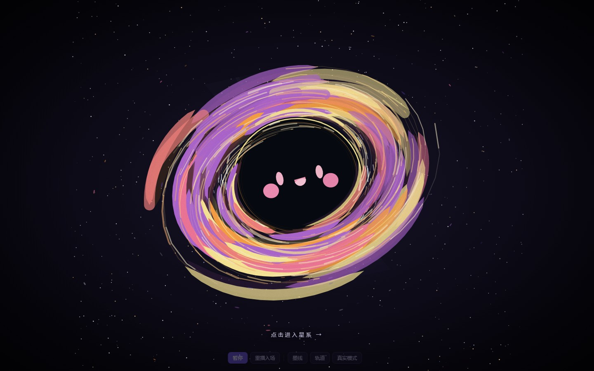

# 个人主页

一个纯前端的个人主页。首页是一整幅黑洞，点击任意位置进入太阳系，逐颗浏览十颗星球。

<p align="center">
  
</p>

<p align="center">
  
  
</p>

## 页面

| 页面 | 文件 | 说明 |
|---|---|---|
| 黑洞主页 | `index.html` | 单文件：内联 SVG + 内联 GSAP，无外部请求，双击也能打开。整块画面是入口，点击跳转 `viewer.html` |
| 星系角色 | `viewer.html` | 走 `src/main.js`，十颗角色按页切换，底部按钮翻页 |

## 本地运行

需要 Node.js `^20.19.0` 或 `>=22.12.0`。

```bash
npm install
npm run dev         # http://127.0.0.1:5173
npm run build       # 产物写入 dist/
npm run preview     # 预览 dist/
```

## 构建与部署

`npm run build` 会同时产出 `index.html` 与 `viewer.html`，两个入口登记在 `vite.config.js` 里。`dist/` 是纯静态目录，可直接托管；部署到子路径时在 `vite.config.js` 中设置 `base`。

## 目录结构

```
index.html                 黑洞主页
viewer.html                星系角色浏览页
vite.config.js             构建配置（两个入口）
docs/                      README 用的截图
src/
├── main.js                角色表、几何换算、单角色浏览
├── style.css              页面样式
├── characters/            十个角色，每个 index.js / scene.js / anim.js
├── core/                  与角色无关的运行层：注册表、姿态、混合、输入、时钟
├── shared/                纯函数工具：缓动、时钟、输入、入场、眨眼、冲量
└── assets/                位图素材，按角色分目录，统一 1536 画布
```

## 技术栈

| 项 | 说明 |
|---|---|
| 构建 | Vite 7 |
| 动画 | GSAP 3 |
| 图形 | 原生 SVG + 位图素材 |
| 框架 | 无 |

## 关于素材

`星球素材/`（手绘原稿）与 `_draft/`（草稿与脚本）只在本地保留，已在 `.gitignore` 中排除，仓库里只有页面实际用到的 `src/assets/`。克隆后这两个目录为空是正常的。
